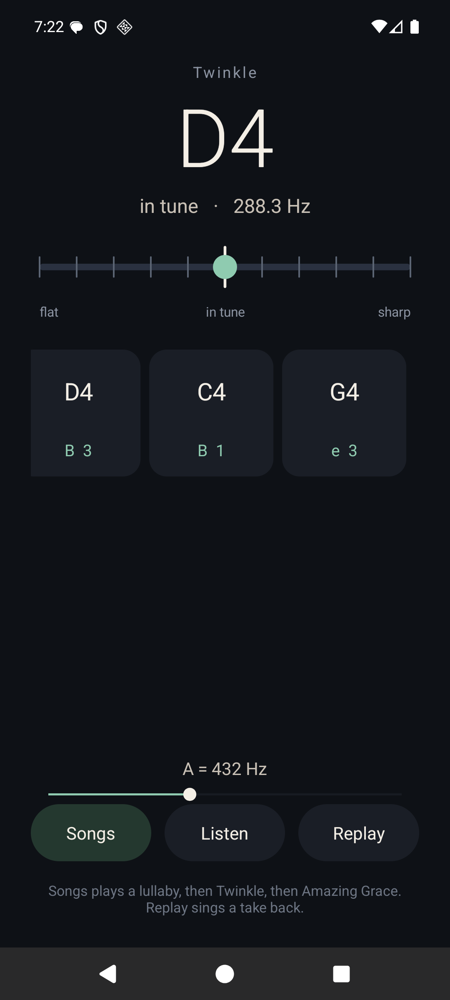
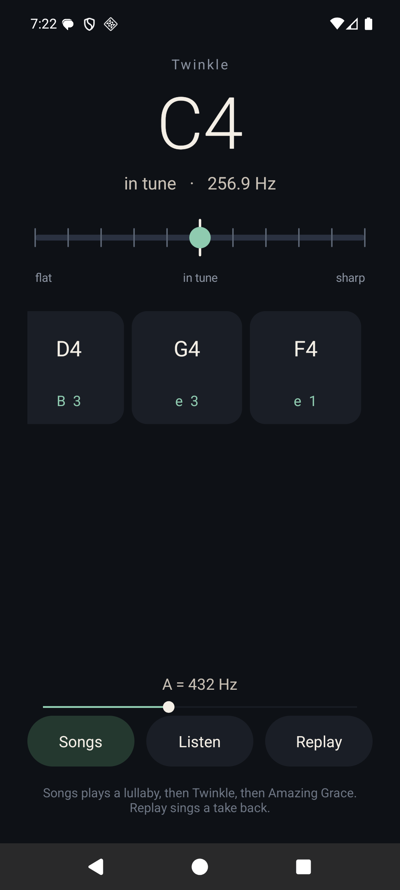

# lullabae

Alpha. Version `0.1.0-alpha`.

lullabae listens to one pitch at a time. Hum a line, or let a song play, and the note is written down when it ends, with how many cents it sits from the tuning pitch and a guitar fret under it. A loud hit with no pitch is a tap. Replay sings the written notes back.

The tuning pitch is a slider from 400 to 480 Hz. The songs, the gauge, and the written notes follow it. 432 and 415 are in that range.

This build follows one pitch. A second part that is louder than the tune, a chord, or a full band is not written as a score.





## What is in a pre-release

Pushes to `main` build two archives and attach them to a GitHub pre-release tagged `v0.1.0-alpha.<run>`:

- `lullabae-android-0.1.0-alpha.<run>.apk` is the Android app only. Install it on a device or an emulator running Android 8 or newer.
- `lullabae-web-0.1.0-alpha.<run>.zip` is the browser page only. Unpack it and serve the folder over http. The page listens in the browser and does not upload the audio.

## Build it here

The pitch core, the checks, the Android app, and the browser page all use the C++ in `pitch-detector-skeleton`.

```bash
cd pitch-detector-skeleton
g++ -std=c++17 -O2 -o pitchtest main.cpp PitchDetector.cpp Transcriber.cpp midi.cpp replay.cpp -lm
./pitchtest
```

Android, from a machine with the SDK, build-tools 36.0.0, platform android-36, and NDK 28.2.13676358:

```bash
./android/build.sh
```

That writes `android/build/lullabae.apk`. `./android/run.sh` builds it, installs it on a connected emulator, and opens it.

Browser, with [Emscripten](https://emscripten.org/) installed:

```bash
./web/build.sh
python3 web/serve.py
```

Open `http://127.0.0.1:8731`.

## License

MIT. See [LICENSE](LICENSE).
